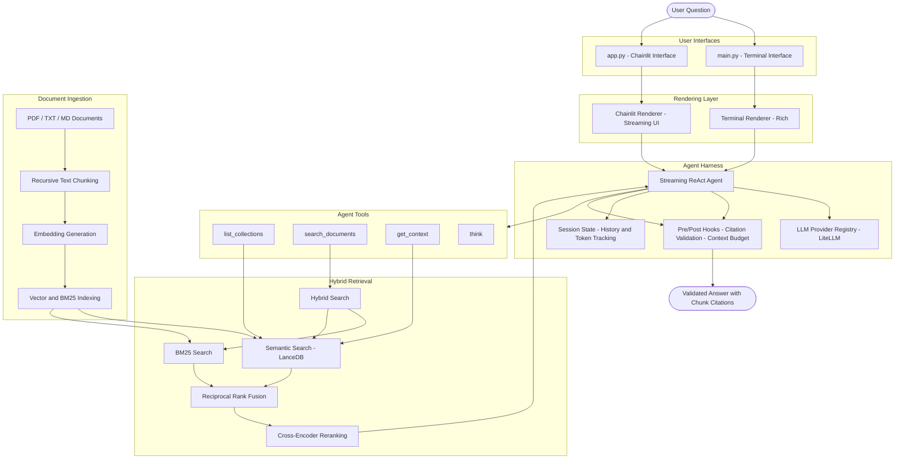

# 🤖 Agentic RAG with LLM Evaluation Harness

### Intelligent Document Retrieval with Agentic Reasoning, Hybrid Search, and LLM Evaluation

An agentic Retrieval-Augmented Generation (RAG) system that reasons over unstructured documents using a streaming ReAct loop. The agent autonomously decides when and how to search, iteratively refines queries, retrieves relevant context, and validates citations before presenting its final answer.

**Built with Python, LiteLLM, LanceDB, BM25, Sentence Transformers, Cross-Encoders, and Chainlit.**

---

## 🌟 Overview

Traditional RAG systems generally retrieve relevant documents and pass the retrieved context to an LLM to generate an answer.

This project explores an **Agentic RAG architecture** in which an AI agent can decide which retrieval tools to use, search iteratively, expand relevant context, and reason over retrieved information before generating a response.

The system combines semantic search, keyword-based retrieval, cross-encoder reranking, and citation validation to improve the relevance and traceability of generated answers.

An evaluation-oriented harness provides controls around retrieval, context management, agent execution, and answer validation.

The project supports multiple LLM providers and two interaction interfaces:

- Rich-powered terminal interface.
- Chainlit browser interface.

## ✨ Key Features

### 🧠 Agentic RAG Architecture
- Streaming ReAct agent loop.
- Autonomous tool selection.
- Iterative document search.
- Multi-step reasoning support.
- Context-aware answer generation.
- Session history management.

### 🔍 Hybrid Information Retrieval
- BM25 keyword-based search.
- Semantic vector search using cosine similarity.
- Reciprocal Rank Fusion (RRF).
- Cross-encoder reranking.
- Neighboring chunk retrieval for context expansion.

### 🤖 Multi-Provider LLM Integration
- Anthropic Claude.
- OpenAI GPT.
- Google Gemini.
- Provider switching through configuration.
- LiteLLM-based provider abstraction.

### 📚 Document Ingestion
- Text document ingestion.
- Markdown document ingestion.
- PDF ingestion through optional local parsing support.
- Recursive character text splitting.
- Overlapping document chunks.
- Local embedding generation.
- LanceDB vector storage.
- BM25 index creation and persistence.

### 🛡️ Evaluation and Reliability Controls
- Citation validation against retrieved chunk IDs.
- Retrieved-context token budget.
- Agent execution iteration limit.
- Context expansion.
- Answer revision when citation validation fails.
- Session state tracking.

### 💻 Multiple User Interfaces
- Rich terminal interface.
- Chainlit browser interface.
- Real-time streaming of tool calls and answer tokens.

---

## 🏗️ System Architecture

The following diagram illustrates the major components and their interactions.



---

## 🧰 Technology Stack

| Category | Technologies |
|---|---|
| Programming Language | Python |
| LLM Integration | LiteLLM |
| AI Models | Anthropic Claude, OpenAI GPT, Google Gemini |
| Agent Architecture | ReAct Agent Loop |
| Retrieval Architecture | Agentic Hybrid RAG |
| Vector Database | LanceDB |
| Keyword Retrieval | BM25 / BM25Okapi |
| Embeddings | Sentence Transformers |
| Embedding Model | `BAAI/bge-small-en-v1.5` |
| Reranking | Cross-Encoder |
| Reranker Model | `cross-encoder/ms-marco-MiniLM-L-6-v2` |
| Rank Fusion | Reciprocal Rank Fusion (RRF) |
| Document Processing | TXT, Markdown, PDF |
| PDF Parsing | `liteparse` (optional) |
| Terminal Interface | Rich |
| Web Interface | Chainlit |
| Package Management | uv |
| Configuration | Python configuration and environment variables |

---

## 📁 Project Structure

```text
Agentic-RAG-with-LLM-Evaluation-Harness/
│
├── harness/
│   ├── agent.py
│   │   └── Core streaming ReAct agent loop
│   │
│   ├── providers.py
│   │   └── LiteLLM wrapper and provider registry
│   │
│   ├── tools.py
│   │   └── Agent tool implementations and JSON schemas
│   │
│   ├── hooks.py
│   │   └── Middleware, citation validation and context budget
│   │
│   └── state.py
│       └── Session history, chunk IDs and token tracking
│
├── ingestion/
│   ├── chunker.py
│   │   └── Recursive character text splitting
│   │
│   ├── pipeline.py
│   │   └── Chunking, embedding and indexing pipeline
│   │
│   └── ingest.py
│       └── Document ingestion CLI
│
├── retrieval/
│   ├── search.py
│   │   └── Hybrid search, reranking and result formatting
│   │
│   ├── vector_store.py
│   │   └── LanceDB vector storage and retrieval
│   │
│   ├── bm25.py
│   │   └── BM25 indexing and keyword search
│   │
│   └── embeddings.py
│       └── Sentence Transformer and Cross-Encoder wrappers
│
├── renderers/
│   ├── base.py
│   │   └── Abstract renderer interface
│   │
│   ├── terminal.py
│   │   └── Rich terminal renderer
│   │
│   └── chainlit.py
│       └── Chainlit browser renderer
│
├── sample_docs/
│   └── Example documents for testing
│
├── .env.example
├── .gitignore
├── .python-version
│
├── IMPLEMENTATION_PLAN.md
├── PIPELINE.md
├── RAG_AGENT_HARNESS.md
├── README.md
├── chainlit.md
├── config.py
├── main.py
├── app.py
├── demo.html
└── pyproject.toml
```

---

## 🚀 Getting Started

### 1. Prerequisites

Make sure you have:

- Python version specified in `.python-version`.
- `uv` package manager.
- An API key for at least one supported LLM provider.
- Internet connectivity for model API access.
- Sufficient local storage for embedding models and document indexes.

### 2. Clone the Repository

```bash
git clone https://github.com/pushpakrai/Agentic-RAG-with-LLM-Evaluation-Harness.git

cd Agentic-RAG-with-LLM-Evaluation-Harness
```

### 3. Create a Virtual Environment

```bash
uv venv
```

Activate the environment.

**Windows PowerShell:**

```powershell
.venv\Scripts\Activate.ps1
```

**Linux / macOS:**

```bash
source .venv/bin/activate
```

### 4. Install Dependencies

```bash
uv pip install -e .
```

For optional PDF ingestion support:

```bash
uv pip install liteparse
```

### 5. Configure API Keys

Create your environment file from the provided template.

**Windows PowerShell:**

```powershell
Copy-Item .env.example .env
```

**Linux / macOS:**

```bash
cp .env.example .env
```

Configure the API key for your selected provider:

```env
ANTHROPIC_API_KEY=your_anthropic_api_key
OPENAI_API_KEY=your_openai_api_key
GEMINI_API_KEY=your_gemini_api_key
```

You only need the key for the provider you intend to use.

Keep `.env` private and never commit actual API keys to GitHub.

---

## 📥 Document Ingestion

The ingestion pipeline processes documents and prepares them for retrieval.

### Ingest a Directory

```bash
python -m ingestion.ingest --path ./sample_docs --collection docs
```

### Ingest a Single File

```bash
python -m ingestion.ingest --path report.pdf --collection reports
```

### Supported Document Formats

| Format | Extension | Support |
|---|---|---|
| Text | `.txt` | Supported |
| Markdown | `.md` | Supported |
| PDF | `.pdf` | Optional `liteparse` dependency |

### Ingestion Workflow

1. Read source documents.
2. Split documents into overlapping text chunks.
3. Generate embeddings using Sentence Transformers.
4. Store vector representations in LanceDB.
5. Build and persist the BM25 index.
6. Make the indexed collection available for retrieval.

---

## 💬 Asking Questions

### 1. Single Question — Terminal

```bash
python main.py "What was ACME's Q3 revenue?"
```

### 2. Interactive Terminal Mode

```bash
python main.py
```

### 3. Select a Different LLM Provider

```bash
python main.py --provider openai-fast "What are the key risks mentioned?"
```

### 4. Launch Browser Interface

```bash
chainlit run app.py
```

The Chainlit interface provides an interactive way to ask questions and observe streaming agent activity.

---

## 🤖 Supported LLM Providers

The application provides multiple model configurations through its provider registry.

| Provider Key | Model | Description |
|---|---|---|
| `gemini-fast` | `gemini-2.5-flash` | Default fast model |
| `gemini-smart` | `gemini-2.5-pro` | Higher-capability Gemini model |
| `anthropic-fast` | `claude-haiku-4-5` | Fast Claude model |
| `anthropic-smart` | `claude-sonnet-4-6` | Advanced Claude model with extended thinking enabled |
| `openai-fast` | `gpt-4o-mini` | Lightweight OpenAI model |
| `openai-smart` | `gpt-4o` | Advanced OpenAI model |

Select the provider through the CLI or application configuration.

---

## 🛠️ Agent Tools

The agent has access to tools that help it retrieve information and reason over documents.

| Tool | Description |
|---|---|
| `list_collections` | Lists available indexed document collections |
| `search_documents` | Performs hybrid BM25 and semantic search with reranking |
| `get_context` | Retrieves a selected chunk and neighboring chunks |
| `think` | Provides a scratchpad for multi-step reasoning |

### Agent Execution Workflow

The ReAct agent can:

1. Analyze the user's question.
2. Decide whether document retrieval is necessary.
3. Select an appropriate tool.
4. Search the indexed document collection.
5. Examine retrieved results.
6. Expand context when necessary.
7. Continue reasoning or perform additional retrieval.
8. Generate an evidence-supported answer.

The agent runs with a maximum of 10 iterations according to the current implementation.

---

## 🔍 Hybrid Retrieval Pipeline

The retrieval system combines keyword search and semantic search.

### 1. BM25 Keyword Search

BM25 retrieves documents based on lexical relevance and keyword matching.

It helps identify documents containing important terms from the user's question.

### 2. Semantic Vector Search

Sentence Transformers generate embeddings using:

`BAAI/bge-small-en-v1.5`

The embeddings are stored in LanceDB and used for cosine similarity-based retrieval.

Semantic search helps identify relevant content even when the wording differs from the original question.

### 3. Reciprocal Rank Fusion

The system combines BM25 and semantic search rankings using Reciprocal Rank Fusion (RRF).

This helps balance keyword relevance and semantic similarity.

### 4. Cross-Encoder Reranking

Retrieved candidates are reranked using:

`cross-encoder/ms-marco-MiniLM-L-6-v2`

The reranker evaluates query-document relevance before the selected results are passed to the agent.

### 5. Context Expansion

The `get_context` tool retrieves neighboring chunks around a relevant result.

This allows the agent to inspect additional information surrounding a selected passage.

---

## 🛡️ LLM Evaluation and Citation Validation

The harness includes controls intended to improve the reliability of generated responses.

### Citation Validation

Retrieved document chunks have identifiers.

The agent uses chunk IDs to reference supporting information in its response.

A post-processing hook checks whether cited chunk IDs were actually retrieved.

If an answer contains hallucinated chunk identifiers, the validation mechanism triggers a revision workflow.

### Context Budget Management

The harness enforces a maximum retrieved-context token budget.

Default:

```python
max_retrieved_tokens = 8000
```

This helps prevent excessive retrieved context from overflowing the configured prompt budget.

### Agent Iteration Control

The ReAct loop has a maximum execution limit to prevent uncontrolled tool execution.

### Session State

The session state tracks:

- Conversation history.
- Retrieved chunk IDs.
- Token usage information.

> These are evaluation-oriented reliability controls. They do not establish that every generated factual claim is correct or that the system has undergone a formal benchmark evaluation.

---

## ⚙️ Configuration

The main configuration is maintained in `config.py`.

| Setting | Default | Description |
|---|---|---|
| `provider` | `gemini-fast` | Default LLM provider |
| `search_k` | `10` | Number of candidates retrieved before reranking |
| `rerank_top_k` | `5` | Number of results retained after reranking |
| `context_window_size` | `2` | Neighboring chunks retrieved by `get_context` |
| `max_retrieved_tokens` | `8000` | Maximum retrieved-context token budget |
| `embedding_model` | `BAAI/bge-small-en-v1.5` | Local embedding model |
| `reranker_model` | `cross-encoder/ms-marco-MiniLM-L-6-v2` | Cross-encoder reranking model |
| `lance_db_path` | `./corpus.lance` | LanceDB storage location |

Modify these settings according to your document collection, model provider, and retrieval requirements.

---

## 📊 Traditional RAG vs Agentic RAG

| Traditional RAG | Agentic RAG |
|---|---|
| Usually follows a predefined retrieval workflow | Agent can decide when to retrieve |
| Typically performs a fixed retrieval step | Supports iterative retrieval |
| Limited retrieval control | Tool-based retrieval decisions |
| Context often assembled in one step | Supports additional context expansion |
| Answer generated from initial retrieved results | Agent can inspect and refine evidence |
| Citation checks may be absent | Includes chunk-ID citation validation |

The architecture in this project explores how agent-driven retrieval and validation mechanisms can improve the transparency and controllability of RAG workflows.

---

## 📚 Additional Documentation

The repository includes additional technical documentation:

| Document | Description |
|---|---|
| [PIPELINE.md](PIPELINE.md) | Detailed ingestion and answering pipeline walkthrough |
| [RAG_AGENT_HARNESS.md](RAG_AGENT_HARNESS.md) | Agent harness documentation |
| [IMPLEMENTATION_PLAN.md](IMPLEMENTATION_PLAN.md) | Implementation plan and development details |
| [chainlit.md](chainlit.md) | Chainlit interface documentation |

---

## 🔮 Future Enhancements

Potential areas for extending the project include:

- Automated retrieval evaluation using benchmark datasets.
- Faithfulness and answer relevance scoring.
- Context precision and context recall metrics.
- LLM-as-a-Judge evaluation.
- Retrieval performance benchmarking.
- Advanced multi-agent collaboration.
- Query decomposition and query rewriting.
- Persistent conversational memory.
- Improved document parsing and metadata extraction.
- Observability and agent execution tracing.
- Automated evaluation reports and dashboards.
- Production deployment and API integration.

---

## 🤝 Contributing

Contributions, suggestions, and improvements are welcome!

To contribute:

1. Fork the repository.
2. Create a feature branch.

```bash
git checkout -b feat/your-feature
```

3. Implement and test your changes.
4. Commit your changes.

```bash
git add .
git commit -m "feat: add your feature"
```

5. Push your branch.

```bash
git push origin feat/your-feature
```

6. Open a Pull Request.

Please include relevant documentation and tests when introducing new functionality.

---

## 🔐 Security

- Store API keys in environment variables.
- Never commit `.env` files containing actual credentials.
- Use `.env.example` only for placeholder configuration.
- Avoid logging API keys or sensitive document content.
- Review dependencies and update them when necessary.

---

## 🙏 Acknowledgments

This project is built using the following technologies and open-source ecosystems:

- [Python](https://www.python.org/) — Core programming language.
- [LiteLLM](https://www.litellm.ai/) — Unified LLM provider interface.
- [Anthropic](https://www.anthropic.com/) — Claude language models.
- [OpenAI](https://openai.com/) — GPT models.
- [Google Gemini](https://ai.google.dev/) — Gemini language models.
- [LanceDB](https://lancedb.com/) — Vector database.
- [Sentence Transformers](https://www.sbert.net/) — Embedding and reranking models.
- [Hugging Face](https://huggingface.co/) — Model ecosystem.
- [Chainlit](https://chainlit.io/) — Conversational AI application interface.
- [Rich](https://github.com/Textualize/rich) — Terminal formatting and rendering.
- [uv](https://docs.astral.sh/uv/) — Python package and environment management.

---

## 📄 License

This project is licensed under the **MIT License**.

See the [LICENSE](LICENSE) file for details.

---

## 👨‍💻 Author

**Pushpak Rai**

- GitHub: [@pushpakrai](https://github.com/pushpakrai)
- LinkedIn: [Pushpak Rai](https://www.linkedin.com/in/pushpak-rai-0ab3a3200/)

---

**Building intelligent RAG systems through agentic reasoning, hybrid retrieval, and reliable LLM evaluation.**
