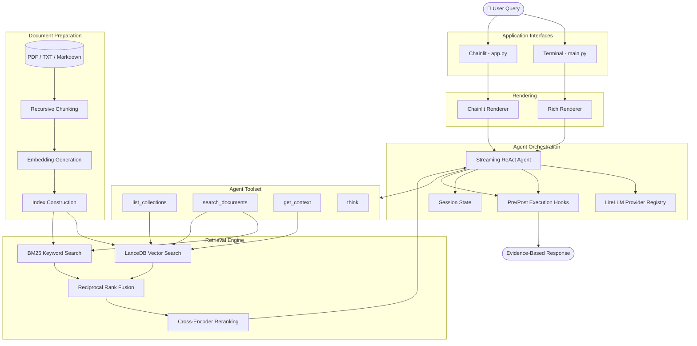

# 🤖 Agentic RAG with LLM Evaluation Harness

### Building Context-Aware AI Systems Through Agentic Reasoning and Hybrid Retrieval

An intelligent Retrieval-Augmented Generation (RAG) application that enables an LLM-powered agent to explore document collections, select retrieval tools, gather supporting context, and generate evidence-backed responses.

Unlike a conventional one-step RAG workflow, this project uses a **streaming ReAct agent architecture** that supports iterative retrieval, contextual exploration, and citation validation.

**Core technologies:** Python · LiteLLM · LanceDB · BM25 · Sentence Transformers · Cross-Encoders · Chainlit

---

## 🌐 Project Overview

Retrieving relevant information is only one part of building a reliable document-based AI application. An effective system must also manage context, select useful evidence, and maintain traceability between generated answers and source documents.

This project brings these capabilities together through an agent-oriented architecture.

The agent can:

- Interpret a user's question and determine the next action.
- Select appropriate document retrieval tools.
- Combine keyword-based and semantic search results.
- Refine its information gathering through multiple iterations.
- Expand relevant passages using neighboring document chunks.
- Generate responses with references to retrieved chunk identifiers.
- Validate citations through post-processing hooks.

The application also provides multiple LLM providers and interfaces, making it possible to interact with the same agent through a terminal or browser.

## ✨ Core Capabilities

| Capability                | Implementation                    |
| ------------------------- | --------------------------------- |
| 🧠 Agent orchestration    | Streaming ReAct execution loop    |
| 🔎 Hybrid retrieval       | BM25 and semantic similarity      |
| 🔀 Result combination     | Reciprocal Rank Fusion            |
| 🎯 Relevance refinement   | Cross-encoder reranking           |
| 📚 Document indexing      | Chunking, embeddings, and LanceDB |
| 🔗 Context exploration    | Neighboring chunk retrieval       |
| 🛡️ Citation checks       | Retrieved chunk ID validation     |
| 📏 Context management     | Retrieved-token budget            |
| 🔌 Model integration      | LiteLLM provider abstraction      |
| 💻 Application interfaces | Rich terminal and Chainlit        |

### 🧠 Agent-Based Information Retrieval

The agent is not restricted to a single retrieval operation. It can select tools, inspect returned information, and continue retrieving evidence when additional context is needed.

### 🔍 Combined Search Strategy

Two retrieval approaches work together:

- **BM25:** Finds relevant content through keyword matching.
- **Semantic search:** Finds conceptually related passages using vector similarity.

Their rankings are combined using RRF before cross-encoder reranking.

### 🛡️ Answer Reliability Mechanisms

The harness includes citation validation, execution limits, session tracking, and context-budget controls. These mechanisms help manage the answering process and improve traceability.

---

## 🏗️ Architecture

The application is organized into five major layers: interfaces, rendering, agent orchestration, retrieval, and document ingestion.



### 🔄 Request Lifecycle

1. **Input:** A question enters through the terminal or Chainlit interface.
2. **Reasoning:** The ReAct agent evaluates the question and selects an action.
3. **Tool execution:** The selected tool accesses the document retrieval components.
4. **Evidence retrieval:** Keyword and semantic results are combined and reranked.
5. **Context inspection:** The agent can retrieve neighboring chunks for additional information.
6. **Response generation:** The LLM generates an answer using the gathered evidence.
7. **Validation:** Post-processing checks cited chunk identifiers against retrieved evidence.
8. **Output:** The response is streamed to the selected interface.

---

## 🧰 Technology Ecosystem

| Area                   | Technology                             |
| ---------------------- | -------------------------------------- |
| Language               | Python                                 |
| LLM abstraction        | LiteLLM                                |
| Agent pattern          | ReAct                                  |
| Language models        | Claude, GPT, Gemini                    |
| Vector storage         | LanceDB                                |
| Keyword retrieval      | BM25 / BM25Okapi                       |
| Embedding framework    | Sentence Transformers                  |
| Embedding model        | `BAAI/bge-small-en-v1.5`               |
| Reranking framework    | Cross-Encoder                          |
| Reranking model        | `cross-encoder/ms-marco-MiniLM-L-6-v2` |
| Ranking fusion         | Reciprocal Rank Fusion                 |
| Document formats       | TXT, Markdown, PDF                     |
| Optional PDF parser    | liteparse                              |
| Terminal rendering     | Rich                                   |
| Browser interface      | Chainlit                               |
| Environment management | uv                                     |

---

## 📂 Repository Layout

```text
Agentic-RAG-with-LLM-Evaluation-Harness/
│
├── harness/
│   ├── agent.py
│   ├── providers.py
│   ├── tools.py
│   ├── hooks.py
│   └── state.py
│
├── ingestion/
│   ├── chunker.py
│   ├── pipeline.py
│   └── ingest.py
│
├── retrieval/
│   ├── search.py
│   ├── vector_store.py
│   ├── bm25.py
│   └── embeddings.py
│
├── renderers/
│   ├── base.py
│   ├── terminal.py
│   └── chainlit.py
│
├── sample_docs/
│
├── .env.example
├── .gitignore
├── .python-version
├── IMPLEMENTATION_PLAN.md
├── PIPELINE.md
├── RAG_AGENT_HARNESS.md
├── README.md
├── chainlit.md
├── config.py
├── main.py
├── app.py
├── demo.html
└── pyproject.toml
```

### 🧩 Main Components

| Component                   | Responsibility                                          |
| --------------------------- | ------------------------------------------------------- |
| `harness/agent.py`          | Executes the streaming ReAct loop                       |
| `harness/providers.py`      | Manages LLM provider configurations                     |
| `harness/tools.py`          | Defines agent tools and their schemas                   |
| `harness/hooks.py`          | Handles middleware, citation checks, and context limits |
| `harness/state.py`          | Maintains conversation and retrieval state              |
| `ingestion/chunker.py`      | Splits source documents into chunks                     |
| `ingestion/pipeline.py`     | Coordinates embedding and indexing                      |
| `ingestion/ingest.py`       | Provides the ingestion command-line interface           |
| `retrieval/search.py`       | Coordinates hybrid retrieval and reranking              |
| `retrieval/vector_store.py` | Provides LanceDB operations                             |
| `retrieval/bm25.py`         | Handles keyword indexing and search                     |
| `retrieval/embeddings.py`   | Provides embedding and reranking model wrappers         |
| `renderers/`                | Implements terminal and browser output                  |

---

## 🚀 Installation and Setup

### 1. Requirements

Before starting, prepare:

- Python version configured in `.python-version`.
- [uv](https://docs.astral.sh/uv/) package manager.
- An API key for at least one supported LLM provider.
- Internet access for model API requests.
- Local storage for downloaded models and document indexes.

### 2. Download the Repository

```bash
git clone https://github.com/pushpakrai/Agentic-RAG-with-LLM-Evaluation-Harness.git

cd Agentic-RAG-with-LLM-Evaluation-Harness
```

### 3. Set Up the Environment

```bash
uv venv
```

Activate the virtual environment.

**Windows PowerShell**

```powershell
.venv\Scripts\Activate.ps1
```

**Linux / macOS**

```bash
source .venv/bin/activate
```

### 4. Install Project Dependencies

```bash
uv pip install -e .
```

Install the optional PDF parser if PDF ingestion is required:

```bash
uv pip install liteparse
```

### 5. Configure Model Credentials

Create your local environment file.

**Windows PowerShell**

```powershell
Copy-Item .env.example .env
```

**Linux / macOS**

```bash
cp .env.example .env
```

Add the relevant credentials to `.env`:

```env
ANTHROPIC_API_KEY=your_anthropic_api_key
OPENAI_API_KEY=your_openai_api_key
GEMINI_API_KEY=your_gemini_api_key
```

Only configure the credentials required by your selected provider.

**Security:** Never publish actual API credentials or commit your private `.env` file.

---

## 📥 Document Ingestion

The ingestion module prepares source files for retrieval by converting documents into chunks, generating embeddings, and building searchable indexes.

### Ingest a Document Collection

```bash
python -m ingestion.ingest --path ./sample_docs --collection docs
```

### Ingest an Individual File

```bash
python -m ingestion.ingest --path report.pdf --collection reports
```

### Supported Input Types

| Extension | Format        | Availability                  |
| --------- | ------------- | ----------------------------- |
| `.txt`    | Plain text    | Supported                     |
| `.md`     | Markdown      | Supported                     |
| `.pdf`    | PDF documents | Requires optional `liteparse` |

### Ingestion Sequence

```text
Source Documents
       |
       v
Document Loading
       |
       v
Recursive Text Chunking
       |
       v
Embedding Generation
       |
       +--------------------+
       |                    |
       v                    v
  LanceDB Index         BM25 Index
       |                    |
       +---------+----------+
                 |
                 v
          Searchable Data
```

---

## 💬 Running the Application

### 🖥️ Terminal — Single Query

```bash
python main.py "What was ACME's Q3 revenue?"
```

### 🔁 Interactive Terminal Session

```bash
python main.py
```

### 🔌 Choose an LLM Provider

```bash
python main.py --provider openai-fast "What are the key risks mentioned?"
```

### 🌐 Start the Chainlit Interface

```bash
chainlit run app.py
```

The browser interface allows users to interact with the agent while observing streamed execution activity.

---

## 🤖 LLM Provider Configuration

The provider registry uses LiteLLM to expose different model configurations through a consistent interface.

| Provider Key      | Model               | Intended Use                                |
| ----------------- | ------------------- | ------------------------------------------- |
| `gemini-fast`     | `gemini-2.5-flash`  | Default fast configuration                  |
| `gemini-smart`    | `gemini-2.5-pro`    | Higher-capability Gemini configuration      |
| `anthropic-fast`  | `claude-haiku-4-5`  | Fast Claude configuration                   |
| `anthropic-smart` | `claude-sonnet-4-6` | Claude configuration with extended thinking |
| `openai-fast`     | `gpt-4o-mini`       | Lightweight OpenAI configuration            |
| `openai-smart`    | `gpt-4o`            | Advanced OpenAI configuration               |

Switching providers does not require redesigning the retrieval architecture.

---

## 🛠️ Agent Toolset

The agent uses a collection of tools to interact with indexed documents.

| Tool               | Purpose                                                   |
| ------------------ | --------------------------------------------------------- |
| `list_collections` | Discovers available document collections                  |
| `search_documents` | Performs hybrid retrieval with reranking                  |
| `get_context`      | Fetches a selected chunk and neighboring passages         |
| `think`            | Supports intermediate reasoning within the agent workflow |

### Agent Execution Limits

The current ReAct implementation supports a maximum of **10 iterations**.

This provides a boundary for repeated tool execution and multi-step retrieval.

---

## 🔬 Inside the Retrieval Engine

The retrieval layer combines lexical matching, semantic similarity, ranking fusion, and relevance reranking.

### 1. 🔤 Lexical Retrieval — BM25

BM25 identifies passages based on query terms and document relevance.

It is useful when a question contains specific names, terminology, identifiers, or phrases that appear in the source material.

### 2. 🧬 Semantic Retrieval — Embeddings

The project uses:

```text
BAAI/bge-small-en-v1.5
```

Sentence Transformer embeddings represent document chunks as vectors. LanceDB stores these vectors and supports cosine similarity-based retrieval.

This allows the system to find conceptually related passages even when the wording differs.

### 3. 🔀 Reciprocal Rank Fusion

BM25 and semantic search produce separate result rankings.

Reciprocal Rank Fusion combines these rankings into a unified candidate list, allowing lexical and semantic relevance to contribute to retrieval.

### 4. 🎯 Cross-Encoder Reranking

The candidate results are reranked using:

```text
cross-encoder/ms-marco-MiniLM-L-6-v2
```

Unlike relying only on initial retrieval scores, the cross-encoder evaluates the relevance of query-document pairs before the final candidates are returned.

### 5. 📖 Context Expansion

The `get_context` tool retrieves neighboring chunks around a selected result.

This helps the agent inspect surrounding information instead of relying exclusively on an isolated passage.

---

## 🛡️ Evaluation-Oriented Reliability Controls

The harness includes several mechanisms to manage the agent's execution and inspect the evidence used in its answers.

### 🔗 Citation Validation

Document chunks have identifiers that can be referenced in generated responses.

A post-processing hook checks whether cited chunk IDs belong to the retrieved evidence.

When invalid identifiers are detected, the configured revision workflow can request a corrected answer.

### 📏 Retrieved Context Budget

The application limits the amount of retrieved context passed through the answering workflow.

```python
max_retrieved_tokens = 8000
```

This helps control prompt size and retrieved-context consumption.

### 🔄 Execution Management

The agent has an iteration limit to constrain repeated tool calls.

### 🧠 Session Tracking

The session state maintains information such as:

- Conversation history.
- Retrieved chunk identifiers.
- Token-count information.

> **Important:** These mechanisms are reliability and evaluation-oriented controls. Citation validation does not independently establish factual correctness, and the presence of these controls does not mean that a formal benchmark evaluation suite or automated faithfulness scoring has been implemented.

---

## ⚙️ Application Configuration

The primary settings are maintained in `config.py`.

| Parameter              | Default                                | Function                                      |
| ---------------------- | -------------------------------------- | --------------------------------------------- |
| `provider`             | `gemini-fast`                          | Default LLM configuration                     |
| `search_k`             | `10`                                   | Initial retrieval candidate count             |
| `rerank_top_k`         | `5`                                    | Number of retained reranked results           |
| `context_window_size`  | `2`                                    | Neighboring chunks retrieved by `get_context` |
| `max_retrieved_tokens` | `8000`                                 | Retrieved-context token limit                 |
| `embedding_model`      | `BAAI/bge-small-en-v1.5`               | Embedding model                               |
| `reranker_model`       | `cross-encoder/ms-marco-MiniLM-L-6-v2` | Reranking model                               |
| `lance_db_path`        | `./corpus.lance`                       | Local vector-store path                       |

These values can be adjusted in the project configuration according to the retrieval workload and document collection.

---

## ⚖️ Traditional RAG and Agentic RAG

| Traditional RAG                              | This Agentic RAG Approach                    |
| -------------------------------------------- | -------------------------------------------- |
| Usually uses a predefined retrieval sequence | Uses a tool-enabled reasoning loop           |
| Commonly retrieves context in a fixed step   | Can perform additional retrieval iterations  |
| Limited control over retrieval decisions     | Agent selects retrieval tools                |
| Often uses initially retrieved passages      | Supports neighboring context expansion       |
| Generates an answer from retrieved context   | Can inspect evidence before final generation |
| May not validate source references           | Includes retrieved chunk ID validation       |

The objective is to explore how agent-controlled retrieval can make document-based question answering more flexible and traceable.

---

## 📚 Project Documentation

Additional technical documentation is available in the repository.

| File                     | Contents                                     |
| ------------------------ | -------------------------------------------- |
| `PIPELINE.md`            | Ingestion and answering pipeline walkthrough |
| `RAG_AGENT_HARNESS.md`   | Agent harness implementation documentation   |
| `IMPLEMENTATION_PLAN.md` | Project implementation plan                  |
| `chainlit.md`            | Chainlit interface instructions              |

---

## 🧪 Potential Improvements

Possible future development directions include:

- Automated evaluation using RAG benchmark datasets.
- Faithfulness and answer relevance scoring.
- Context precision and context recall measurements.
- LLM-as-a-Judge evaluation.
- Retrieval latency and performance benchmarking.
- Query decomposition and query rewriting.
- Multi-agent coordination.
- Persistent conversational memory.
- Advanced document parsing and metadata extraction.
- Agent execution tracing and observability.
- Evaluation dashboards and automated reports.
- Production API deployment.

---

## 🤝 Contributing

Contributions and technical suggestions are welcome.

To contribute:

**1. Fork the repository.**

**2. Create a feature branch.**

```bash
git checkout -b feat/your-feature
```

**3. Implement and test your changes.**

**4. Commit your work.**

```bash
git add .
git commit -m "feat: describe your change"
```

**5. Push the branch.**

```bash
git push origin feat/your-feature
```

**6. Submit a Pull Request.**

Please include appropriate documentation and tests when introducing new functionality.

---

## 🔐 Security Guidelines

- Keep API credentials in environment variables.
- Do not commit `.env` files containing real credentials.
- Use placeholder values in `.env.example`.
- Avoid exposing sensitive document content in application logs.
- Review third-party dependencies and update them when appropriate.

---

## 🙌 Acknowledgments

This project builds on several open-source tools and AI ecosystems:

- [Python](https://www.python.org/) — Application development.
- [LiteLLM](https://www.litellm.ai/) — Unified model provider integration.
- [Anthropic](https://www.anthropic.com/) — Claude models.
- [OpenAI](https://openai.com/) — GPT models.
- [Google AI](https://ai.google.dev/) — Gemini models.
- [LanceDB](https://lancedb.com/) — Vector storage and search.
- [Sentence Transformers](https://www.sbert.net/) — Embedding and reranking models.
- [Hugging Face](https://huggingface.co/) — Model ecosystem.
- [Chainlit](https://chainlit.io/) — Conversational application interface.
- [Rich](https://github.com/Textualize/rich) — Terminal rendering.
- [uv](https://docs.astral.sh/uv/) — Python environment and package management.

---

## 📄 License

This project is intended to use the MIT License.

See the repository's `LICENSE` file for the license terms.

---

## 👨‍💻 Author

**Pushpak Rai**

- 🐙 GitHub: [@pushpakrai](https://github.com/pushpakrai)
- 💼 LinkedIn: [Pushpak Rai](https://www.linkedin.com/in/pushpak-rai-0ab3a3200/)

---

\<p align="center">   \<strong>⚡ Exploring the next generation of document intelligence with agentic reasoning, hybrid retrieval, and evidence-aware AI.\</strong> \</p>
